  <!-- Animated introduction -->
  
  
  

  <b>Informatics Engineering Student · Web & Mobile Developer · Tech Enthusiast</b>
  

  <!-- Animated contribution graph, refreshed daily by GitHub Actions -->
  <h3><code>muhamaddikrulloh@github ~ $ ./contributions.sh</code></h3>
  
  
  
  <!-- ASCII portrait and GitHub statistics -->
  <h3><code>muhamaddikrulloh@github ~ $ whoami</code></h3>
  
  <table>
  <tr>
  <td valign="top"></td>
  <td valign="top"></td>
  </tr>
  </table>
  
   
  
  <!-- Social links -->
  <h3><code>muhamaddikrulloh@github ~ $ ./links.sh</code></h3>
  
  
  
  
  
  

